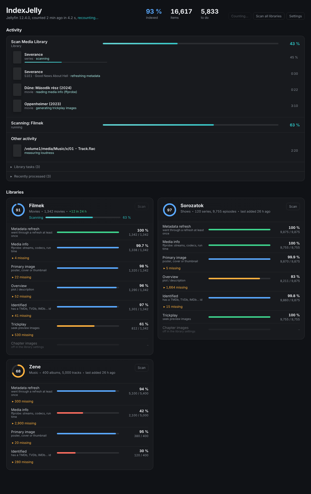

<p align="center"></p>

<h1 align="center">IndexJelly for Jellyfin</h1>

**[English](#english) · [Magyar](#magyar)**



---

## English

IndexJelly is a Jellyfin server plugin that shows **how far the server is with indexing your libraries**: which scans and library tasks are running right now, and for every library how many items already have media info, metadata, images, trickplay and chapter images. You can open a list of the items that are still missing any of these.

The page lives in the Jellyfin dashboard (left menu → *IndexJelly*). Only administrators can see it. The interface follows the Jellyfin display language: Hungarian for Hungarian, English for everything else.

### Features

- **Activity**: running scheduled tasks (library scan, trickplay, chapter images, keyframes…) and per-library scans with live progress. When nothing is running, it shows when the last library scan finished and how. The library tasks can be started from here.
- **Job details, Plex style**: under every running task, the items it is working on right now: thumbnail, title (click it to open the item's page), the operation (reading media info, generating trickplay images, extracting an image…) and the elapsed time. Folders being scanned (e.g. a series) show their own progress. Work that belongs to no running task, like a manual refresh, shows under *Outside scheduled tasks*. *Recently processed* lists the last items added, refreshed, updated or removed.
- **Library cards**: an overall indexed percentage (ring), item counts by type, items added in the last 24 hours, a live scan bar, and a *Scan* button for that library.
- **Checks per library**, each with a progress bar and done / applicable counts:

| Check | Counts | Passes when |
|---|---|---|
| Metadata refresh | everything | the item went through at least one metadata refresh |
| Media info | videos, tracks | ffprobe ran: the database has a video (or audio) stream for the item |
| Primary image | movies, series, episodes, albums, music videos | it has a primary image (poster, cover, thumbnail) |
| Overview | movies, series, episodes | it has a description |
| Identified | movies, series, episodes, albums, music videos | it has at least one provider id (TMDb, TVDb, IMDb, MusicBrainz…) |
| Trickplay | videos, if trickplay is on for the library | trickplay images exist |
| Chapter images | videos with chapters, if chapter image extraction is on for the library | every chapter has an image |

- **Missing lists**: click *N missing* under a check to see the items, with a link to each item, the date it was added and the file path.
- **Buttons**: *Recount* starts a new count. *Scan all libraries* starts a library scan.

### How counting works

Scan and task progress is live: the page polls every 2 seconds while something is being indexed and every 5 seconds otherwise, and elapsed times tick every second. Counting the items is heavier: it means one database lookup per video for streams, trickplay and chapters. So the count runs **in the background** and the result is cached (5 minutes by default). The page always shows the last finished count and when it was made. When the cached count gets old, opening the page starts a new one. While indexing runs it is recounted at most every minute, and right after an indexing task or scan finishes. On a library of a few thousand items, a count takes a few seconds.

Extras (trailers, featurettes), seasons and virtual (missing) episodes are not counted.

### Settings

Settings are behind the *Settings* button: refresh interval, how old a count may get, list limit per check, file paths on/off, and the trickplay and chapter checks on/off. The trickplay and chapter checks are the slowest part of a count on big libraries.

### Requirements

- Jellyfin **12.4** (built against `Jellyfin.Controller` 12.4.0, .NET 10). For another 12.x version, change `JellyfinVersion` in the `.csproj` and `targetAbi` in `meta.json`.
- To build: Docker **or** the .NET 10 SDK.

### Build

```sh
sh build.sh                                  # uses dotnet if installed, Docker otherwise
dotnet publish -c Release -o bin/publish     # by hand
```

`build.sh` puts the result into `dist/IndexJelly_<version>/` (`Jellyfin.Plugin.IndexJelly.dll`, `meta.json`, `thumb.png`). When building by hand, copy only these three files, never the other Jellyfin / Microsoft DLLs from `bin/publish`.

### Install

#### From the plugin repository

1. Dashboard → Plugins → *Repositories* → **+**
   - Name: `IndexJelly`
   - URL: `https://raw.githubusercontent.com/burgatshow/indexjelly/main/manifest.json`
2. *Catalog* → **IndexJelly** → *Install*, then restart Jellyfin.

#### Manual

Copy the `IndexJelly_<version>` folder (or the unzipped release) into the Jellyfin plugins directory (Docker: `/config/plugins/`, on the Synology NAS for example `/volume1/docker/jellyfin/config/plugins/`), then restart Jellyfin.

### API

`GET /IndexJelly/Status[?recount=true]`: libraries, checks, running tasks. Administrators only.
`GET /IndexJelly/Missing?libraryId=<id>&check=<key>`: the items missing a check, from the last count. Check keys: `refreshed`, `mediaInfo`, `primaryImage`, `overview`, `providerIds`, `trickplay`, `chapterImages`.

### Limitations

- Jellyfin has no API that tells which item a task is working on. IndexJelly works it out from two sources. The first is the refresh and library events, which it attaches at server start, so restart Jellyfin once after installing. The second is the running ffmpeg / ffprobe processes, matched to library items by their input file. Reading the processes needs Linux (the official Docker image is fine). Elsewhere, only the refresh events are shown. Playback transcodes are left out; StreamJelly shows those.
- Trickplay and chapter data have no stable public API across Jellyfin versions (the services were renamed several times). IndexJelly finds them by name at runtime. If a future version changes them, that check is shown as *not readable in this Jellyfin version* and the rest keeps working.
- *Media info* checks whether the database has the stream. Files that ffprobe cannot read (broken files, some `.strm` links) stay missing.
- Episodes without their own image use a frame extracted from the video. If image extraction is off, many episodes show up under *Primary image*.

### Releasing

1. Bump the version in the `.csproj` (`AssemblyVersion`, `FileVersion`) and in `meta.json`. `build.sh` reads it from the `.csproj`.
2. Add the version to `CHANGELOG.md` (both languages).
3. `sh release.sh`: builds `dist/indexjelly_<version>.zip` and `dist/release-notes.md`, and adds the version to `manifest.json`.
4. GitHub → Releases → new release, tag `v<version>`, attach the zip, publish.
5. Commit and push `manifest.json`.

---

## Magyar

Az IndexJelly egy Jellyfin szerver plugin, amely megmutatja, **hol tart a szerver a könyvtárak indexelésével**: milyen szkennelés és könyvtári feladat fut éppen, és könyvtáranként hány elemnél van már mediainfó, metaadat, kép, trickplay és fejezetkép. Ami még hiányzik, azt listában is meg tudod nézni.

Az oldal a Jellyfin vezérlőpultján érhető el (bal oldali menü → *IndexJelly*), és csak rendszergazda látja. A felület a Jellyfin megjelenítési nyelvét követi: magyar nyelvnél magyarul, minden más nyelvnél angolul jelenik meg.

### Funkciók

- **Folyamatban**: a futó ütemezett feladatok (könyvtárszkennelés, trickplay, fejezetképek, keyframe-ek…) és a könyvtáranként futó szkennelések élő haladással. Ha semmi nem fut, azt látod, mikor és milyen eredménnyel ért véget az utolsó szkennelés. A könyvtári feladatok innen is indíthatók.
- **Feladat-részletek a Plexhez hasonlóan**: minden futó feladat alatt látszik, mely elemeken dolgozik éppen. Mindegyiknél ott a bélyegkép, a cím (kattintásra az elem adatlapjára visz), a művelet (mediainfó olvasása, trickplay képek készítése, kép kinyerése…) és az eltelt idő. A szkennelt mappák (pl. egy sorozat) saját haladást is mutatnak. Ami nem tartozik futó feladathoz (pl. egy kézi frissítés), az a *Feladaton kívüli munka* alatt jelenik meg. A *Nemrég feldolgozva* listában az utoljára hozzáadott, frissített, módosított vagy törölt elemek látszanak.
- **Könyvtár-kártyák**: összesített indexeltségi arány (gyűrű), elemszám típusonként, az elmúlt 24 órában hozzáadott elemek, élő szkennelési sáv és *Szkennelés* gomb az adott könyvtárhoz.
- **Ellenőrzések könyvtáranként**, mindegyik haladásjelzővel és kész / összes számmal:

| Ellenőrzés | Mire vonatkozik | Mikor teljesül |
|---|---|---|
| Metaadat-frissítés | minden elemre | legalább egyszer lefutott rá a metaadat-frissítés |
| Mediainfó | videók, zeneszámok | lefutott az ffprobe: van videó- (vagy hang-) stream az adatbázisban |
| Elsődleges kép | filmek, sorozatok, epizódok, albumok, zenei videók | van poszter, borító vagy bélyegkép |
| Leírás | filmek, sorozatok, epizódok | van ismertető |
| Azonosítva | filmek, sorozatok, epizódok, albumok, zenei videók | van legalább egy provider ID (TMDb, TVDb, IMDb, MusicBrainz…) |
| Trickplay | videók, ha a könyvtárban be van kapcsolva | vannak trickplay képek |
| Fejezetképek | fejezetekkel rendelkező videók, ha a könyvtárban be van kapcsolva | minden fejezetnek van képe |

- **Hiánylisták**: egy ellenőrzés alatt az *N hiányzik* feliratra kattintva megjelennek az érintett elemek: link az elemre, a hozzáadás dátuma és a fájl útvonala.
- **Gombok**: *Újraszámolás* (új számolást indít) és *Összes könyvtár szkennelése*.

### Hogyan számol

A szkennelések és feladatok haladása élő: indexelés közben az oldal 2, egyébként 5 másodpercenként kérdezi le, az eltelt idők pedig másodpercenként frissülnek. Az elemek számolása nehezebb művelet: videónként egy adatbázis-lekérdezést jelent a stream-ekre, a trickplayre és a fejezetekre. Ezért a számolás **a háttérben** fut, és az eredmény gyorsítótárba kerül (alapból 5 percig). Indexelés közben a számolás legfeljebb percenként, egy feladat befejezése után pedig azonnal újraindul. Az oldal mindig az utolsó befejezett számolást mutatja, és azt is, hogy mikor készült. Ha a számolás elavult, az oldal megnyitásakor újraindul. Néhány ezer elemes könyvtárnál ez pár másodperc.

Az extrák (előzetesek, kisfilmek), az évadok és a virtuális (hiányzó) epizódok nem számítanak bele.

### Beállítások

A *Beállítások* gomb mögött: frissítési gyakoriság, hány perc után számoljon újra, listalimit ellenőrzésenként, fájlútvonalak, valamint a trickplay- és a fejezetkép-ellenőrzés be- és kikapcsolása. Nagy könyvtáraknál ez a két ellenőrzés a számolás leglassabb része.

### Követelmények, fordítás, telepítés

Ugyanaz, mint a StreamJelly-nél: Jellyfin **12.4** (.NET 10), fordítás `sh build.sh` paranccsal (dotnet vagy Docker kell hozzá). Telepítés a plugin-adattárból:

`https://raw.githubusercontent.com/burgatshow/indexjelly/main/manifest.json`

Vagy kézzel: a `dist/IndexJelly_<verzió>` mappát másold a Jellyfin `plugins` könyvtárába (például `/volume1/docker/jellyfin/config/plugins/`), majd indítsd újra a Jellyfint.

### Korlátok

- A Jellyfinnek nincs olyan API-ja, amely megmondaná, melyik elemen dolgozik éppen egy feladat. Az IndexJelly ezt két forrásból rakja össze. Az egyik a frissítési és könyvtári események: ezekre a szerver indulásakor iratkozik fel, ezért telepítés után egyszer indítsd újra a Jellyfint. A másik a futó ffmpeg / ffprobe folyamatok, amelyeket a bemeneti fájljuk alapján párosít a könyvtár elemeivel. A folyamatok olvasásához Linux kell (a hivatalos Docker image megfelel), máshol csak az eseményekből származó adatok látszanak. A lejátszáshoz tartozó átkódolások nem jelennek meg, azokat a StreamJelly mutatja.
- A trickplay- és a fejezetadatokhoz nincs stabil nyilvános API: a szolgáltatásokat a Jellyfin többször átnevezte. Az IndexJelly ezért futásidőben, név alapján keresi meg őket. Ha egy későbbi verzió megváltoztatja ezeket, az adott ellenőrzésnél a *nem olvasható ebben a Jellyfin verzióban* felirat jelenik meg, a többi ellenőrzés pedig továbbra is működik.
- A *Mediainfó* azt nézi, hogy a stream benne van-e az adatbázisban. Azok a fájlok, amelyeket az ffprobe nem tud beolvasni (sérült fájlok, egyes `.strm` linkek), hiányzóként maradnak a listában.
- Ha egy epizódnak nincs saját képe, a Jellyfin a videóból vett képkockát használja. Ha a képkinyerés ki van kapcsolva, sok epizód megjelenik az *Elsődleges kép* hiánylistájában.

### Kiadás

A verziót a `.csproj` fájlban és a `meta.json`-ban kell átírni, a változásokat pedig felvenni a `CHANGELOG.md`-be. Ezután `sh release.sh`, majd a GitHub Release-t kézzel kell létrehozni a zip-pel, végül commitolni és pusholni a `manifest.json`-t.
